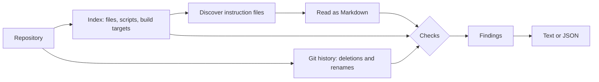

# Architecture

Tidybee reads a repository once, finds its instruction files, and runs a list of checks over them. It never runs anything from the repository.

1. **Index.** The list of files comes from `git ls-files`, so `.gitignore` is followed exactly. Without Git it walks the folder and skips the usual build and dependency folders. The same step reads every `package.json`, Makefile and justfile for script and target names, and works out the package manager from lockfiles.
2. **History.** One `git log` reads the recent deletions and renames, so that a missing path can be explained.
3. **Discover.** The files an agent reads are picked out by name and place, and each is marked as always read, read for matching files, or read on request.
4. **Read.** Each is read into headings, links, `` `code spans` ``, shell blocks and imports, with line and column. The header of a Cursor rule or a skill is read as well.
5. **Check.** Each check is a function that takes the context and returns findings. Adding a check is adding a function to the list in `src/engine.ts`.
6. **Report.** Findings are sorted by file and line, the less certain ones are filtered out, and the result is printed.

## Code

| File                                               | What it does                                                                                       |
| -------------------------------------------------- | -------------------------------------------------------------------------------------------------- |
| `src/cli.ts`, `src/run.ts`                         | The command line. `run` takes its input and output as arguments, so it is tested without a process |
| `src/engine.ts`                                    | Runs the checks, filters and sorts, and builds the report                                          |
| `src/analyze.ts`                                   | Reads the files into a context and works out when each is loaded                                   |
| `src/discover.ts`                                  | Which files are instruction files, and of which agent                                              |
| `src/repo.ts`, `src/project.ts`                    | The file index, and the scripts, targets and package manager                                       |
| `src/git.ts`, `src/gitrun.ts`                      | Git history, and the one safe way Tidybee runs Git                                                 |
| `src/markdown.ts`, `src/tokens.ts`, `src/paths.ts` | The Markdown reader, the token estimate, path arithmetic                                           |
| `src/checks/`                                      | One file for each group of checks, listed in `docs/checks.md`. `context.ts` is what they share     |
| `src/glob.ts`, `src/text.ts`                       | The glob matcher without regular expressions, and what a character does (hidden, control, entropy) |
| `src/report.ts`                                    | Text and JSON output. Text from a file is written out before it is printed                         |

## Safety

Tidybee is meant to be run on repositories you did not write. It only reads. It does not run scripts, install anything or follow a command it finds in a file. The one thing it executes is `git`, always with fixed arguments and with `core.fsmonitor` turned off, because a repository's own settings can name a program for Git to run, and with that setting even `git ls-files` runs it. A test builds such a repository and checks that nothing runs. Another checks that a run leaves the repository, including the Git index, exactly as it was.

The files it reads are chosen by the repository's author, so it is also built not to hang or run out of memory on a crafted one. No regular expression is made from what is read, a glob is matched without one, every repeated part of the ones that remain has a limit, an instruction file is read to 2 MB and at most 500 are checked, and the inputs that were once slow are tests with time limits. See [decision 0005](decisions/0005-hostile-input-is-bounded.md).

Text from the repository reaches the terminal inside messages, so the text report writes every control, direction, zero-width and tag character as `\u{...}` first. A file with an escape sequence in it cannot move the cursor or hide a finding. A finding about a secret shows four characters of it and its length, never the value. See [decision 0006](decisions/0006-safety-findings-never-print-secrets.md).
